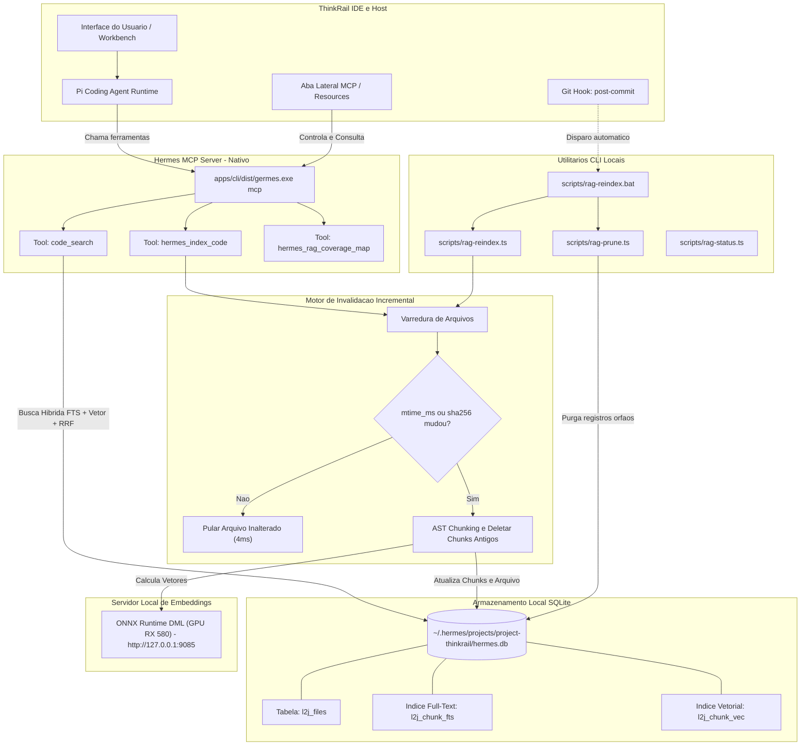

# ThinkRail

[](https://confluence.jetbrains.com/display/ALL/JetBrains+on+GitHub)
[](https://star-history.com/#JetBrains/thinkrail&Date)
[](https://thinkrail.ai/discord)

O ThinkRail é a IDE agêntica que evolui a cada uso — aprendendo a arquitetura do seu projeto hoje por meio de especificações vivas (living specs) e construindo suas próprias ferramentas amanhã.

Construímos uma interface rica em torno do agente de codificação [`pi`](https://www.npmjs.com/package/@earendil-works/pi-coding-agent), isolamos tarefas em workspaces independentes e fornecemos ao agente um conhecimento duradouro do projeto por meio de especificações vivas e skills reutilizáveis. O ThinkRail também possui suporte total a extensões e servidores de contexto MCP para criar as ferramentas necessárias de acordo com o seu fluxo real de desenvolvimento.

**Website:** [thinkrail.ai](https://thinkrail.ai/) · **Blog:** [thinkrail.ai/blog](https://thinkrail.ai/blog/) ·
**Discord:** [thinkrail.ai/discord](https://thinkrail.ai/discord)

⭐ Se você considera o ThinkRail útil, deixe uma estrela — isso ajuda outros desenvolvedores a descobrirem o projeto.

<p align="center">
 <a href="https://www.star-history.com/jetbrains/thinkrail">
  <picture><source media="(prefers-color-scheme: dark)" srcset="https://api.star-history.com/badge?repo=JetBrains/thinkrail&type=rank&theme=dark" /><source media="(prefers-color-scheme: light)" srcset="https://api.star-history.com/badge?repo=JetBrains/thinkrail&type=rank" /></picture> <picture><source media="(prefers-color-scheme: dark)" srcset="https://api.star-history.com/badge?repo=JetBrains/thinkrail&type=trending&theme=dark" /><source media="(prefers-color-scheme: light)" srcset="https://api.star-history.com/badge?repo=JetBrains/thinkrail&type=trending" /></picture>
 </a>
</p>

<picture>
  <source media="(prefers-color-scheme: dark)" srcset=".github/readme-assets/workbench-dark.png">
  
</picture>

*Uma sessão do `pi` e a alteração produzida, delimitada a um workspace isolado por git worktree.*

---

## O Que Você Obtém

- **Workspaces Isolados.** Abra qualquer repositório git como projeto e derive workspaces como `git worktree`s independentes, cada um com sua própria branch e diretório de trabalho. Agentes trabalham em paralelo sem interferir no seu checkout principal; mescle a branch pronta e descarte o restante. Workspaces inativos ou concluídos são arquivados automaticamente na gaveta (shelf) do projeto e voltam ao foco no instante em que você interagir com eles. A barra superior exibe o status da branch ativa contra a `origin` e seu Pull Request, com publicação, push e abertura de PR a um clique de distância.
- **Uma IDE Real em Torno do Agente.** Workbench divisível com abas baseadas no editor Monaco, árvore de arquivos com indicadores visuais de alterações git, visualização de Changed files, terminais integrados e renderizadores de documentos. Deixe comentários de revisão ancorados em linhas de código ou diffs e envie-os ao chat como contexto estruturado, ou abra o worktree na sua IDE preferida.
- **Chats que Transmitem Pensamento em Tempo Real.** Múltiplas sessões concorrentes do `pi` por workspace, cada uma com seu próprio modelo, tokens e custos em tempo real. Interrompa e redirecione raciocínios em andamento, enfileire mensagens de acompanhamento (follow-ups), delegue trabalho para subagentes e acompanhe um plano de tarefas compartilhado (TODO Plan) onde cada etapa concluída pode ser comitada individualmente.
- **Localizador e Paleta de Comandos Unificada.** `⌘K` (ou toque duplo no Shift) abre a paleta que localiza chats, workspaces e projetos em todos os repositórios abertos, executa comandos da aplicação com seus atalhos e navega diretamente para as configurações.
- **Especificações como Fonte da Verdade (Specs).** Um grafo conectado de arquivos `SPEC.md` vive ao lado do código. O agente lê, busca e atualiza esse grafo através de ferramentas dedicadas `spec_*`, garantindo que a intenção técnica e as decisões de arquitetura sobrevivam ao encerramento da sessão.
- **Skills e Workflows.** Suporte nativo a Agent Skills portáteis, acompanhado de workflows integrados para inicialização de projeto, brainstorming de design e envio de pull requests via seu próprio CLI `gh`.
- **Ferramentas Visuais e Interativas.** Pesquisa web aprofundada, perguntas interativas de múltipla escolha que o agente faz no chat em vez de adivinhar preferências, e renderização inline de diagramas Mermaid, comparações de opções lado a lado e mockups visuais antes/depois.
- **Servidores MCP (Model Context Protocol).** Conecte qualquer servidor MCP configurado no seu `mcp.json` do `pi`. O ThinkRail solicita aprovação no chat antes de chamadas que possam alterar dados, mantém servidores definidos pelo repositório bloqueados até sua revisão, autentica servidores OAuth diretamente pelas Configurações e exibe o status de cada servidor ao lado dos recursos da sessão.
- **Hermes Code RAG Nativo & MCP.** Mecanismo de alta performance para indexação incremental e busca de código híbrida (AST + FTS5 + Embeddings Vetoriais) alimentado pelo binário nativo `apps/cli/dist/germes.exe` e SQLite (`hermes.db`). Conta com invalidação cirúrgica por hash SHA-256 e data de modificação (`mtime_ms`), pulando arquivos inalterados em apenas **4 milissegundos** e mantendo o banco sincronizado após cada commit via hook automático.
- **Seus Provedores e Credenciais.** Conecte o [JetBrains AI](https://www.jetbrains.com/ai/) ou qualquer provedor suportado pelo `pi` (OpenAI, Anthropic, Opus 4.8 Opus 4.8, Ollama, OpenRouter, etc.). O ThinkRail não exige criação de contas proprietárias.
- **Servidores Locais e Gateways Personalizados.** Em Configurações → Provedores → **Servidores personalizados**, conecte gateways internos ou servidores locais (LiteLLM, vLLM, Ollama, LM Studio, llama.cpp). O botão **Buscar modelos** mapeia automaticamente o catálogo servido.
- **Aplicativo Desktop ou Navegador.** Disponível como aplicativo desktop nativo ou via CLI `thinkrail` executável em qualquer navegador moderno. O estado local reside de forma segura sob `~/.thinkrail`.
- **Totalmente Localizável.** Configurações de idioma com suporte a Português, Inglês, Espanhol, Russo, Chinês Simplificado e Japonês.
- **Temas e Tipografia Flexíveis.** Temas escuro, claro, minimalista e alto contraste, com suporte a customização de fontes de código (JetBrains Mono, Geist) e espaçamentos.

---

## Arquitetura de Integração: ThinkRail + Hermes Code RAG MCP

O fluxo de dados entre a interface do ThinkRail, o agente de IA, o binário nativo de alta performance `germes.exe` e o banco de dados vetorial opera conforme o diagrama abaixo:



---

## Comandos do Hermes RAG

O repositório fornece scripts nativos de alta velocidade com caminhos relativos ao projeto para manter o Code RAG perfeitamente sincronizado:

```bash
bun run rag:reindex   # Reindexa cirurgicamente apenas arquivos alterados ou novos
bun run rag:status    # Exibe metricas de arquivos, chunks, simbolos e cobertura do banco
bun run rag:prune     # Purga registros orfaos de arquivos deletados ou movidos do repositorio
```

Também é possível invocar o script batch diretamente apontando para diretórios específicos:
```cmd
scripts\rag-reindex.bat apps packages
```

---

## Instalação

O ThinkRail é distribuído como instalador desktop nativo e como binário CLI autônomo. Ambos são publicados com hashes `SHA256SUMS` na [página de lançamentos](https://github.com/JetBrains/thinkrail/releases).

### Versão Desktop

Faça o download do pacote correspondente à sua plataforma:

- **macOS 14+ (Apple Silicon ou Intel)** — abra o arquivo DMG para sua arquitetura:
  `thinkrail-desktop-darwin-arm64.dmg` ou `thinkrail-desktop-darwin-x64.dmg`.
- **Windows x64** — extraia o arquivo ZIP de instalação e execute o instalador.
- **Linux x64 / ARM64** — extraia o tarball e execute `installer` (requer Ubuntu 24.04+ com glibc 2.38+, GTK 3, WebKitGTK 4.1, Ayatana AppIndicator 3 e librsvg 2):

  ```bash
  sudo apt install libgtk-3-0 libwebkit2gtk-4.1-0 libayatana-appindicator3-1 librsvg2-2
  ```

### Linha de Comando (CLI)

O instalador baixa o binário correto, valida a soma de verificação SHA-256 e registra o `thinkrail` no seu PATH.

**macOS / Linux** (e Git Bash no Windows):

```bash
curl -fsSL https://raw.githubusercontent.com/JetBrains/thinkrail/main/install.sh | bash
```

**Windows** (PowerShell ou Prompt de Comando):

```powershell
powershell -c "irm https://raw.githubusercontent.com/JetBrains/thinkrail/main/install.ps1 | iex"
```

Em seguida, execute `thinkrail` passando opcionalmente um diretório para abrir:

```bash
thinkrail ~/meu-projeto
```

---

## Estrutura Interna (Under the Hood)

O ThinkRail é um host enxuto que executa o `pi` in-process e o conecta a uma interface web reativa. O `pi` gerencia modelos, skills, compactação de contexto e custos; o ThinkRail gerencia workspaces, Monaco editor, extensões e o transporte:

1. **Engine Host** — `packages/server` (+ `packages/shared`): Servidor HTTP+WS em `Bun.serve` com sessões `pi` em processo.
2. **The Wire** — `packages/contracts`: Protocolo fortemente tipado e versionado entre o servidor e a UI.
3. **UI Client** — `apps/web`: Desenvolvido em React 19, Zustand e Tailwind v4.

---

## Desenvolvimento do ThinkRail

Requisitos: **Bun** 1.4.4, **Node.js** ≥ 22.19 e credenciais de provedor para execução de agentes.

```bash
git clone https://github.com/JetBrains/thinkrail.git
cd thinkrail
bun install
bun run dev                          # Inicia o host e o cliente web simultaneamente
```

```bash
bun run --filter @thinkrail/cli dev  # Launcher do navegador
bun run build:binary                 # Compila o artefato CLI autônomo
bun run desktop:dev                  # Empacota e executa o app Electrobun Desktop
bun run desktop:build                # Empacota o app desktop sem abrir
```

Consulte [`CONTRIBUTING.md`](CONTRIBUTING.md) para diretrizes de contribuição, execução de suítes de testes E2E e formatação.

---

## Comunidade

Participe do nosso servidor no [Discord](https://thinkrail.ai/discord) para tirar dúvidas, compartilhar experiências e conversar com a equipe. Problemas e sugestões de melhorias podem ser enviados nas [GitHub Issues](https://github.com/JetBrains/thinkrail/issues).

## Licença

Distribuído sob a licença [Apache 2.0](LICENSE).
