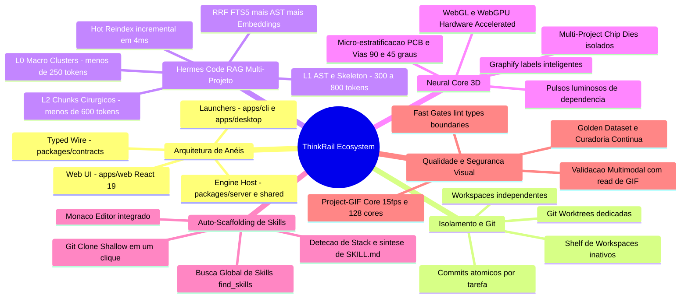
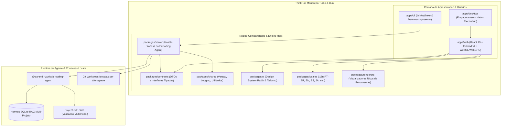
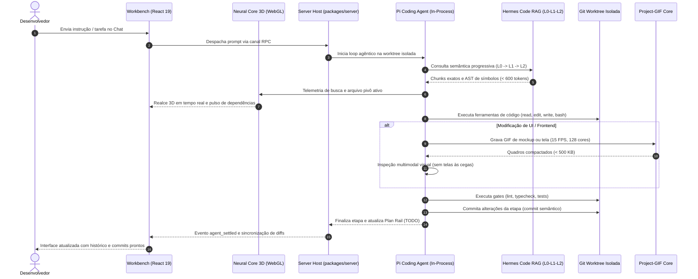
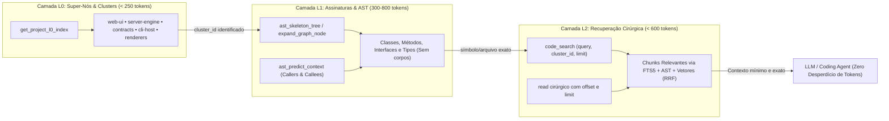

# ThinkRail

[](https://confluence.jetbrains.com/display/ALL/JetBrains+on+GitHub)
[](https://star-history.com/#JetBrains/thinkrail&Date)
[](https://thinkrail.ai/discord)
[](packages/shared/src/version.ts)
[](https://www.npmjs.com/package/@earendil-works/pi-coding-agent)

O **ThinkRail** é a IDE agêntica de nova geração que evolui a cada uso — aprendendo a arquitetura do seu projeto através de especificações vivas (*living specs*), inspecionando código e interfaces visualmente com IA multimodal e sintetizando suas próprias ferramentas de forma autônoma.

Construído sobre o motor do agente [`pi`](https://www.npmjs.com/package/@earendil-works/pi-coding-agent) rodando em processo, o ThinkRail isola cada fluxo em *worktrees* Git independentes, conecta-se a bases de código gigantescas via **Hermes Code RAG Multi-Projeto** e dispõe de um ecossistema completo de **Agent Skills com Auto-Scaffolding em 1-clique**.

**Website:** [thinkrail.ai](https://thinkrail.ai/) · **Blog:** [thinkrail.ai/blog](https://thinkrail.ai/blog/) ·
**Discord:** [thinkrail.ai/discord](https://thinkrail.ai/discord)

⭐ Se você considera o ThinkRail útil, deixe uma estrela — isso ajuda outros desenvolvedores a descobrirem o projeto.

<p align="center">
 <a href="https://www.star-history.com/jetbrains/thinkrail">
  <picture><source media="(prefers-color-scheme: dark)" srcset="https://api.star-history.com/badge?repo=JetBrains/thinkrail&type=rank&theme=dark" /><source media="(prefers-color-scheme: light)" srcset="https://api.star-history.com/badge?repo=JetBrains/thinkrail&type=rank" /></picture> <picture><source media="(prefers-color-scheme: dark)" srcset="https://api.star-history.com/badge?repo=JetBrains/thinkrail&type=trending&theme=dark" /><source media="(prefers-color-scheme: light)" srcset="https://api.star-history.com/badge?repo=JetBrains/thinkrail&type=trending" /></picture>
 </a>
</p>

<picture>
  <source media="(prefers-color-scheme: dark)" srcset=".github/readme-assets/workbench-dark.png">
  
</picture>

*Uma sessão do `pi` e a alteração produzida, delimitada a um workspace isolado por git worktree.*

---

## 🗺️ Mapa de Conhecimento do Ecossistema ThinkRail



---

## ⚡ Os Superpoderes do ThinkRail

### 1. Workspaces Totalmente Isolados com Git Worktrees
Abra qualquer repositório Git como projeto e derive múltiplos workspaces simultâneos como `git worktree`s independentes. Cada workspace possui sua própria branch, histórico e diretório físico. Os agentes realizam refatorações e testes massivos em paralelo sem interferir no seu checkout principal; mescle a branch validada e descarte o restante com um único clique. Workspaces inativos são preservados na gaveta (*shelf*) e restaurados instantaneamente sob demanda.

### 2. Hub de Skills & Auto-Scaffolding em 1-Clique (Hermes Skills Engine)
O ThinkRail transforma qualquer repositório aberto do GitHub em uma ferramenta utilizável pelo agente:
- **Busca Global Comunitária (`find_skills`):** Localize instantaneamente skills e repositórios populares por estrelas e relevância direto pelo chat ou pela aba lateral.
- **Auto-Scaffolding Inteligente:** Repositórios sem formato de skill pré-existente são inspecionados automaticamente: o ThinkRail lê a documentação, detecta a stack tecnológica (Python, Node/Bun/TypeScript, Rust ou CLI genérica) e **sintetiza um `SKILL.md` operacional completo na hora**, pronto para uso pelo agente.
- **Interface Transparente:** Visualize o nome da pasta física da skill e abra o arquivo `SKILL.md` no editor do Monaco com um clique.

### 3. Validação Visual Obrigatória com IA Multimodal (Project-GIF Core)
Diga adeus a telas desenvolvidas às cegas:
- **Motor Headless Integrado:** Grava animações em GIF de alta performance (< 500 KB, 15 FPS, quantização em 128 cores com `Dither.NONE`) de componentes web, páginas ativas e mockups em `.thinkrail/context/mockups/`.
- **Inspeção Multimodal pelo Agente:** O agente inspeciona os quadros do GIF via `read()`, avaliando espaçamento, contraste, hierarquia visual e comportamento responsivo antes de finalizar qualquer entrega de UI.

### 4. Hermes Code RAG Nativo & Multi-Projeto
Mecanismo de alta performance para indexação incremental e busca de código híbrida (**AST + FTS5 + Embeddings Vetoriais**):
- **Alimentado por SQLite e Binário Nativo:** Execução em milissegundos com busca concorrente e fusão de ranqueamento recíproco (**RRF**) em múltiplos projetos ativos simultaneamente (`~/.hermes/projects`).
- **Invalidação Cirúrgica:** Ignora arquivos inalterados por hash SHA-256 e `mtime_ms` em apenas **4 milissegundos**, sincronizando bancos através de git hooks pós-commit.
- **Barra de Progresso em Tempo Real:** Acompanhe a varredura e o status de indexação diretamente na barra superior do workbench.

### 5. Neural Core 3D & Arquitetura PCB com Chip Dies
Um visualizador de contexto arquitetural acelerado por **WebGL / WebGPU 3D**:
- **Layout PCB Micro-Estratificado:** Posiciona módulos em plano de circuito impresso com folga anti-colisão e conexões ortogonais/Manhattan (90° e 45°) simulando trilhas e vias reais sem transfixar nós adjacentes.
- **Pulsos Dinâmicos de Dependência:** As conexões ativas entre símbolos e arquivos pulsam em tempo real, rastreando ferramentas invocadas no chat (`read`, `edit`, `write`, `ast_*`, `code_search`).
- **Isolamento de Chip Dies Multi-Projeto:** Projetos indexados no Hermes RAG são dispostos em ilhas (dies) independentes com offsets espaciais próprios no plano XZ.
- **Destaque Poligonal & Conexões Temáticas:** Destaque visual volumétrico das relações entre símbolos, classes e métodos com coloração adaptada ao tema ativo.
- **Visualizador de Chunks & Busca Integrada:** Modal com visualização cirúrgica de chunks de código, contagem de tokens, overview do nó e busca rápida com filtros.
- **HUD Interativo & Navegação Zenital:** Botões de pan direcional, alternância de perspectiva orbital para visão zenital (topo da PCB) e toggle para ocultação da barra de detalhes.

### 6. Plan Rail & Governança de Tarefas com Commits Granulares
- **TODO Integrado:** O agente mantém um plano visível no painel lateral com etapas acionáveis (`pending`, `in_progress`, `done`).
- **Commits Semânticos Passo a Passo:** Cada tarefa concluída no plano é commitada individualmente com mensagens no padrão do seu repositório.
- **Promoção Atômica de Notas:** Transforme ideias e anotações soltas em tarefas estruturadas sem perda de contexto.

### 7. Especificações como Fonte da Verdade (Living Specs)
O ThinkRail utiliza um grafo conectado de arquivos `SPEC.md` que residem junto com o código. As ferramentas dedicadas `spec_*` garantem que decisões arquiteturais, limites de módulos e contratos técnicos sejam respeitados e sobrevivam ao encerramento da conversa.

### 8. Flexibilidade Total de Provedores e Modelos
- Suporte a [JetBrains AI](https://www.jetbrains.com/ai/), OpenAI, Anthropic, Opus 4.8 / 3.5, Ollama, OpenRouter e servidores locais personalizados (LiteLLM, vLLM, LM Studio, llama.cpp).
- Descoberta automática de modelos servidos localmente com mapeamento de capacidades em tempo de execução.

---

## 🏗️ Arquitetura dos Pacotes do Monorepo

O ThinkRail é estruturado como um monorepo Turbo + Bun com separação rígida de camadas e contratos:



---

## 🔄 Ciclo de Execução Agêntica

Fluxo ponta a ponta desde a instrução do desenvolvedor até o commit granular na branch do workspace:



---

## 🎯 Protocolo RAG Progressivo: Contenção de Tokens (L0 ➔ L1 ➔ L2)

Para garantir máxima eficiência de contexto sem estourar janelas de LLMs, o ThinkRail e o Hermes RAG operam em três camadas progressivas obrigatórias:



1. **L0 (Macro-Visão):** Identifica em qual cluster o domínio reside (< 250 tokens).
2. **L1 (Esqueleto de Assinaturas):** Carrega apenas assinaturas, interfaces e chamadas (callers/callees) sem o corpo dos métodos (300-800 tokens).
3. **L2 (Resolução Cirúrgica):** Busca semântica e FTS5 com filtro estrito de `cluster_id` (< 600 tokens).

---

## 🛠️ Comandos & Scripts de Produtividade

O repositório fornece utilitários nativos para gerenciar o ecossistema local:

### Hermes Code RAG
```bash
bun run rag:reindex   # Reindexa cirurgicamente arquivos novos ou alterados
bun run rag:status    # Exibe métricas de arquivos, chunks, símbolos e cobertura
bun run rag:prune     # Purga registros órfãos de arquivos deletados ou movidos
```

### Geração do Binário Standalone (V14)
```bash
# Compila a Web UI e empacota o executável single-file nativo com sufixo de versão
bun run build:binary  # Gera apps/cli/dist/thinkrail-v14.0.2.exe
```

### Validação Visual com Gravação de GIF
```bash
bun scripts/record-ui-gif.ts --mockup .thinkrail/context/mockups/minha-tela.html
# Gera um GIF leve e quantizado em 128 cores para validação multimodal da IA
```

### Verificação de Qualidade e Gates
```bash
bun run typecheck          # Checagem rigorosa de tipos TypeScript em todo o monorepo
bun run lint               # Lint e formatação com Biome
bun run check:boundaries   # Validação de fronteiras arquiteturais entre módulos
bun run check:deps         # Verificação de versões exatas no catálogo
bun run test               # Suíte de testes unitários e de integração
```

---

## 🚀 Instalação & Uso

O ThinkRail está disponível como instalador de desktop nativo e como binário executável CLI/Web (V14).

### Versão Desktop & Binários Autônomos
Faça o download do pacote da sua plataforma na [página de lançamentos](https://github.com/JetBrains/thinkrail/releases):
- **Windows (x64):** Execute o instalador `thinkrail-setup.exe` ou o binário autônomo V14 (`thinkrail.exe` / `thinkrail-v14.0.2.exe`).
- **macOS 14+ (Apple Silicon ou Intel):** Abra o arquivo DMG correspondente ou execute o binário nativo.
- **Linux (x64 / arm64):** Pacotes AppImage ou binários autônomos.

### Modo Web / CLI Local
Para executar diretamente do terminal em qualquer navegador:
```bash
# Clone e instale as dependências
bun install

# Inicie o servidor e abra no navegador
bun run dev
```

Consulte também o [Guia Completo de Compilação](doc/guia-compilacao.md) para detalhes de build das três frentes (Web, CLI e Desktop).

---

## 🌐 Localização & Personalização
- **Idiomas Nativos:** Português (PT-BR), Inglês, Espanhol, Russo, Chinês Simplificado e Japonês.
- **Tipografia & Temas:** Temas Escuro, Claro, Alto Contraste e Minimalista, com fontes de programação customizáveis (JetBrains Mono, Geist).

---

## 📜 Licença
Distribuído sob a licença [Apache 2.0](LICENSE).
